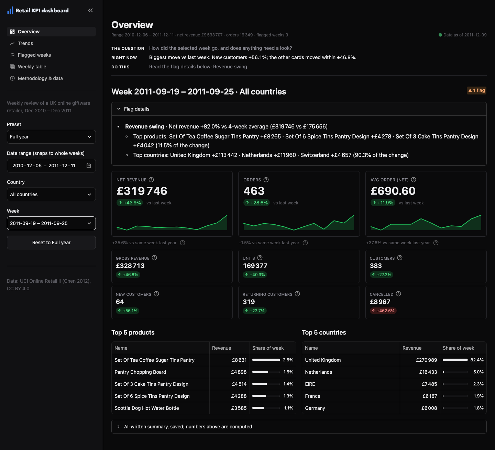

# Retail KPI dashboard

**Live demo:** https://retail-kpi-dashboard.streamlit.app

A weekly KPI review for an online retailer, built in Streamlit on 53 weeks of real transactions (UCI Online Retail II, Dec 2010 – Dec 2011).

**The team task it replaces:** every Monday an ops manager pulls last week's sales into a spreadsheet: revenue, orders, average order value, cancellations, new vs returning customers, top products and countries, what changed and what looks odd. This app does that review in one place. Every number is computed in code, traceable to its formula and inputs, and the same on every page.



## What it does

| Page | What you see |
| --- | --- |
| Overview | A 3-line reading strip (THE QUESTION / RIGHT NOW / DO THIS) whose middle line says what the cards don't ("Biggest move vs last week: New customers -16.2%; the other cards moved within ±7.6%."), a status pill ("● All clear" or "▲ 2 flags") with the flag details and their top drivers open right under it, 3 large cards (net revenue, orders, average net order) with the change vs last week, the change vs the same week last year and a 12-week sparkline, and 6 smaller ones (gross revenue, units, customers, new, returning, cancelled). Each card has a ? with its formula and inputs. Top 5 products and countries with their share of the week, and the saved AI-written summary in a labelled expander |
| Trends | A Net / Gross switch and a 2×2 grid: revenue (flagged weeks marked), orders, returning and new customers, cancelled value. The week with no sales is a gap, never a drop to 0; the partial last week is a grey open circle that doesn't stretch the axis, with a note on its cancellations |
| Flagged weeks | One card per flagged week, newest first, with plain-English labels (No sales, Partial week, Revenue swing, Orders swing, Large cancellations, One big order, Placed and cancelled), each reason in full, and for swings the top 3 products and countries behind the change with how much of it they explain |
| Weekly table | The last 8 weeks by default (switch to all weeks), Week pinned with the selected week highlighted, flag names, net and gross revenue, changes on demand, fits a 1280 px screen without sideways scrolling (long flag names truncate there), and a CSV download of every week |
| Methodology & data | Every KPI formula, the cleaning rules, the flag rules, the data source, known limits, and what the dashboard can add on your own data |

Every data page opens with the same 3-line strip (what question the page answers, the live answer, the next step), and every ? help starts with one plain sentence before the formula. The theme is a calm near-black with blue kept for data, green/red only for good/bad changes and amber only for flagged weeks.

The sidebar holds the filters, and every page recalculates from them: preset (Full year, Q4 2011, UK only, Outside UK), date range (snaps to whole ISO weeks), country (all, UK, outside UK or any single one of the 38 countries with sales in these weeks), week, and **Reset to Full year**. A bad input, such as a date range with only a start date, shows a plain error instead of numbers. Each data page has the same quiet range line under its title (range, net revenue, orders, flagged weeks) and a "Data as of 2011-12-09" note, and a test checks the line matches on every page.

## How it works

```
UCI xlsx (downloaded, SHA-256 checked)
  ──► clean: each line gets one bucket: duplicate · cancellation · adjustment · non-product · non-positive · product
  ──► build: weekly KPI inputs per week × filter value (all / UK / outside UK / each country), 105 weeks so the
            year before is there for year-over-year changes; product revenue and cancellations per week; orders
            matched with their same-week cancellations → data/derived/*.parquet (no customer ids; 2 MB, committed)
  ──► run_scenario(filters): one pure function computes every number the pages show (cached once per filter set)
  ──► 5 thin Streamlit pages
```

- **Calc core** (`kpi/`): Pydantic models and pure functions, no Streamlit imports. Pages only format and lay out what `run_scenario` returns.
- **Net first:** net revenue = revenue − cancelled value is the headline figure on every page; gross is shown next to it.
- **Flags:** net revenue or orders 40% or more above or below their 4-week average (the mean of the previous 4 weeks that had sales; skipped in a week with no sales and the week after one), cancelled value ≥ 25% of revenue, one line > 25% of revenue, an order cancelled in the same week > 25% of revenue (matched on week, stock code, customer and price, inside the build only), no sales, partial week. The 40% threshold was tuned on this data: 25% would flag 20 weeks, 40% flags 9.
- **Drivers:** each swing lists the 3 products (and, for all countries or outside the UK, the 3 countries) that contributed most to the change vs the 4-week average, and what share of the change they explain. Products often explain little (11.5% on 2011-09-19: a broad week), countries a lot (90.3%, mostly the UK), and the dashboard says so instead of implying more.
- **Numbers:** thousands use a narrow space (`£483 725`), never a comma; percentages and money round half-up; the CSV holds raw numbers for spreadsheets.
- **Weekly summaries:** for all countries, the Overview keeps a short summary written by AI in an earlier offline run of a separate reporting tool, where every figure was checked against the computed numbers, inside an expander labelled as AI-written. The headline on top is computed, not written by AI. This app makes no AI calls and no network calls at runtime.

## Results on the real data

Full year, all countries: net revenue £9 593 707 (gross £10 066 085 less £472 377 cancelled) over 19 349 orders. 9 of 53 weeks are flagged: 6 net revenue swings, 3 orders swings, 2 placed-and-cancelled orders, 1 week with no sales (2010-12-27) and 1 partial week (2011-12-05, data ends Friday 2011-12-09).

Net first changed what gets flagged. On gross revenue, 2011-01-17 and 2011-12-05 looked like revenue jumps (+55.9%, +44.1%); on net they are ordinary weeks with one huge order that was cancelled the same week (£77 184 and £168 470, each about 35% of the week's gross), and the dashboard now says exactly that.

| Week | Net revenue | What the dashboard shows |
| --- | --- | --- |
| 2011-11-28 (default, last full week) | £306 112 (+3.7% vs last week, -0.9% vs last year) | 663 orders, average net order £461.71, 514 customers (31 new), no flags |
| 2011-09-19 | £319 746 (+43.9%, +35.6% vs last year) | revenue swing: +82.0% vs its 4-week average (£175 656); top driver Set Of Tea Coffee Sugar Tins Pantry +£8 265; the UK +£113 442 |
| 2011-12-05 | £310 943 (+1.6%; partial week, no year comparison) | 2 flags: partial week (data ends 2011-12-09); placed and cancelled: £168 470, net £0 (Paper Craft , Little Birdie, invoice 581483). Gross £483 725 |

The gross weekly figures match an earlier, independently written implementation of the same rules on both check weeks (acceptance test AC-14); the round-3 numbers (net, year over year, drivers, placed and cancelled) were prototyped separately on the raw data before they were built.

## Measured

- 46 acceptance tests, one per acceptance criterion in `specs/retail-kpi-dashboard.md`. The core tests run on a 15-line fixture whose every value was worked out by hand first (`docs/test-cases.md`). The app tests run every page through Streamlit's `AppTest`: defaults, a preset moving the KPIs, Reset, the same KPI on every page, a bad date range, the week picker, help text, the computed headline and the labelled AI summary, year-over-year captions, the flag status pill, the sparklines, chart gaps and the partial week, the grouped flagged page, the pinned weekly table, the CSV download, attribution, and no network use.
- 418 unit tests on the build and calc core: rounding boundaries, cleaning rules, country filters, the 4-week-average swing rule and its thresholds, placed-and-cancelled matching edge cases, drivers adding up to the change, year-over-year bounds, CSV, and real-data invariants over all 40 filter values × 53 weeks. The invariants include revenue after cancellations = revenue − cancelled, UK + outside UK = all countries, and the sum of single countries = all countries.
- 352 app tests through `AppTest`: every preset, Custom and Reset, week fallback when the range changes, sparse countries on all 5 pages, every card's value, delta, help text and sparkline against the core, gaps in every chart for sparse countries, flag pills and groups, the Net / Gross switch and its axis, driver lines, table toggles, the same net revenue on every page, and the CSV download bytes against the core.
- Rebuilding `data/derived/` from the raw file gives byte-identical tables.

## Run it yourself

```bash
uv sync
make run                      # http://127.0.0.1:8780
```

The derived tables are committed, so the app runs without the raw file. To rebuild them:

```bash
uv run python -m kpi.build    # downloads data/raw/online_retail_II.xlsx (SHA-256 checked) if missing, ~30 s
```

Development: `make check` (ruff, mypy strict, security scans, unit tests) · `uv run pytest tests/acceptance` · `uv run python tools/screenshots.py` (with the app running) writes `docs/screenshots/`.

Streamlit Community Cloud: main file `app.py`, dependencies from `requirements.txt` (exported from `uv.lock` with `make requirements`), Python 3.12.

## Screenshots

| | 1280 px | 1440 px |
| --- | --- | --- |
| Overview (default week) | [overview-1280](docs/screenshots/overview-1280.png) | [overview-1440](docs/screenshots/overview-1440.png) |
| Overview, week 2011-09-19 | [1280](docs/screenshots/overview-week-2011-09-19-1280.png) | [1440](docs/screenshots/overview-week-2011-09-19-1440.png) |
| Overview, UK only | [1280](docs/screenshots/overview-uk-only-1280.png) | [1440](docs/screenshots/overview-uk-only-1440.png) |
| Trends | [1280](docs/screenshots/trends-1280.png) | [1440](docs/screenshots/trends-1440.png) |
| Flagged weeks | [1280](docs/screenshots/flags-1280.png) | [1440](docs/screenshots/flags-1440.png) |
| Weekly table | [1280](docs/screenshots/table-1280.png) | [1440](docs/screenshots/table-1440.png) |
| Methodology & data | [1280](docs/screenshots/methodology-1280.png) | [1440](docs/screenshots/methodology-1440.png) |

## Known limits

- A cancellation counts in the week it happens, not in the week of the original order; placed-and-cancelled matching only looks within one week and needs a customer id.
- Wholesale and retail buyers are mixed, so the average order value blends both. The dataset has no margin or stock data.
- Many lines have no customer id, so customer counts include only lines that have one.
- The ±40% swing rule against the 4-week average is simple: it flags a week for a look; it doesn't judge it, and it doesn't know about seasons; the year-over-year line on the cards is there for that.
- Customer counts are not added up across weeks (one customer can buy in many weeks), so the range line shows revenue and orders only.

## Data

Data: Online Retail II (Chen, D., 2012), UCI Machine Learning Repository, https://doi.org/10.24432/C5CG6D, licensed CC BY 4.0 (https://creativecommons.org/licenses/by/4.0/).

The raw file is downloaded by a script and is not committed. Only weekly aggregates without customer ids are stored in this repo.
